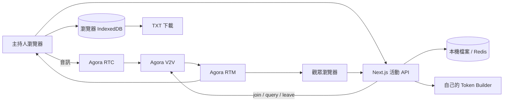

# Lingua Live｜即時雙語字幕

[English](README.en.md) · [部署步驟](docs/deployment.zh-TW.md) · [架構](docs/architecture.md) · [文檔來源](docs/sources.md) · [MIT](LICENSE)

一個為線上活動設計的即時中英字幕作品。主持人使用麥克風或分享瀏覽器分頁音訊，觀眾掃描 QR Code，即可在自己的手機看到原文與翻譯。

專案示範 Agora RTC 音訊傳輸、RTM 字幕接收、V2V 翻譯服務、輕量 Next.js 後端，以及適合手機的連續字幕閱讀流程。可作為技術展示、概念驗證與客製化開發的起點。


## 功能

- 繁體中文 → 英文、英文 → 繁體中文；主持人選擇翻譯方向。
- 麥克風輸入、Chrome／Edge 分頁或系統分享音訊。
- 主持人工作室、QR Code 觀眾頁、桌面雙欄與字幕放大。
- 手機依「原文 1、翻譯 1、原文 2、翻譯 2」閱讀最近 5 組完成字幕及目前更新句；上滑暫停跟隨，按「回到最新字幕」恢復。
- 繁體中文／English 介面切換；字幕提示依來源／目標語言顯示。
- 主持人瀏覽器自動保存文字，下載繁體中文、英文、中英雙語 TXT，附活動經過時間與台北時間。
- RTC／RTM Token 續期、網路重連處理、停止分享後重新選擇音源。
- 本機檔案活動儲存，或 Vercel + Upstash Redis 部署。

## 系統分工



Vercel 處理網頁與短時間控制請求；持續音訊與字幕直接透過 Agora 傳輸。Redis 保存活動與 Agent 狀態，不保存完整逐字稿。沒有會員系統，也不啟用 TTS、音訊錄製或視訊發布。

## 執行前準備

- Node.js **22.x**、npm。
- 同一個 Agora Project 的 App ID、REST Customer ID／Customer Secret，以及 RTC、RTM 與本實作對應的 V2V 服務權限。
- 自己部署的 HTTPS Token Builder，能簽發此專案使用的 combined AccessToken2；請參考 [Token Builder 契約](docs/architecture.md#token-builder-contract)。本 repository 不包含作者的 Worker 或憑證。
- 部署到 Vercel 時，需要 Upstash Redis REST 服務。

本實作的 V2V 接口與公開 STT 範例並非可直接互換。若你的 Project 尚未取得相同服務權限，先向 Agora 確認適用接口與開通條件；[來源與差異說明](docs/sources.md) 有列明。

## 本機啟動

```bash
npm ci
cp .env.example .env.local
```

在 `.env.local` 填入 `AGORA_APP_ID`、`TOKEN_BUILDER_URL`、`AGORA_CUSTOMER_ID`、`AGORA_CUSTOMER_SECRET`。保留已存在的設定，不要覆蓋自己的憑證。

```bash
npm run dev
```

開啟 [http://localhost:3000](http://localhost:3000)，選音源與翻譯方向後按 Quick Start。電腦分享音訊時，選 YouTube 等播放分頁並勾選「分享音訊」；支援範圍由 OS／瀏覽器決定。OBS 可透過可分享的系統音訊，或將監聽聲音送到已安裝的虛擬音訊輸入裝置，再選取該輸入；OBS Virtual Camera 本身不等於音訊來源。本專案不要求安裝音訊驅動。

手機無法連到電腦的 `localhost`。建議使用 Vercel HTTPS 部署；本機也可安裝官方 `cloudflared` 後使用觀眾專用臨時入口：

```bash
npm run build
# 另一個 Terminal：
npm run start -- --port 3002 --hostname 127.0.0.1
# 再開一個 Terminal，需安裝官方 cloudflared：
npm run share
```

臨時入口只開放觀眾路由。QR Code 會更新為當次 HTTPS 網址，Tunnel 停止後連結可能失效。Vercel 部署不需要此閘道或 Tunnel。

## Vercel 與 GitHub

從你提供的 Vercel **Import Project** 畫面可匯入 GitHub repository；也能使用 Vercel CLI，不強制 GitHub。為了版本管理與日後作品維護，本專案建議使用 GitHub 連動部署。

完整操作、環境變數表、Upstash、`SITE_URL` 設定與驗收步驟見 [繁體中文部署指南](docs/deployment.zh-TW.md)／[English deployment guide](docs/deployment.en.md)。所有 Secret 只放 Vercel Environment Variables，不使用 `NEXT_PUBLIC_` 前綴。雲端會拒絕退回本機檔案儲存。

```bash
npm test
npm run typecheck
npm run build
npm run check:public
npm run prepare:public
```

最後一個指令建立 `.release/lingua-live/` 的公開交付副本：以明確白名單複製原始碼、測試、MIT 與公開文件，排除 `.env.local`、`.data/`、`.tools/`、所有建置、內部筆記與舊測試截圖。建議將這份副本初始化成獨立 repository。[驗證範圍](docs/validation.md) 區分自動測試、使用者實測與尚待雲端驗收項目。

## 資料、限制與客製化

- 中文以 OpenCC 在顯示層轉為繁體字；ASR 契約仍使用 `zh-CN`，不宣稱為獨立 `zh-TW` 辨識服務。
- 主持人 IndexedDB 保存實際收到的文字。清除網站資料、私密模式、換網址／瀏覽器、斷線或關頁會影響保留；重要會議結束後請下載備份。
- TXT 發言時間採字幕首次接收的近似時間；不是音訊精確時間碼。
- 觀眾只收到加入後的訊息；斷線期間無法保證補回。RTM 錯誤不等同 RTC 音訊中斷。
- 目前瀏覽器 Token 為 1 小時並會續期；Agent Token 為 24 小時，超過此範圍的 Agent 更新尚未驗證。沒有額外的活動倒數限制。
- 目前展示上限為 20 筆活動記錄、每活動 100 個觀眾身分；不是完成壓力測試後的容量承諾。商用擴大前應調整清理、限流與容量設計。
- iPhone Safari 已由使用者確認可直橫切換；特定 Chrome iOS 18 組合仍有橫向裁切回報，可先使用 Safari／捲動閱讀。

後續可延伸多語、活動管理、品牌主題、音源串接、摘要與後端逐字稿保存。這些延伸尚未實作；客戶可在 MIT 條款下使用自己的服務帳號部署與客製化。正式客戶使用前應依其授權、流量與資料需求完成驗收。

## 文檔與授權

公開來源集中於 [docs/sources.md](docs/sources.md)，包含 Agora RTC／RTM、Token Builder、翻譯概念、Next.js、Vercel、Upstash 與瀏覽器音訊 API。受限服務文件不在公開套件中重製。

作者：Dennis Chen。原始碼採 [MIT License](LICENSE)；Agora、Vercel、Upstash 等服務及第三方套件依各自條款授權。這是獨立展示專案，不代表相關廠商的官方產品或支援承諾。
