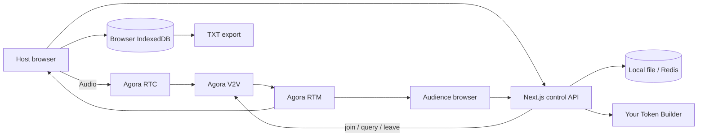

# Lingua Live — Live Bilingual Captions

[繁體中文](README.zh-TW.md) · [Deployment](docs/deployment.en.md) · [Architecture](docs/architecture.md) · [Sources](docs/sources.md) · [MIT](LICENSE)

A portfolio project for live events: a host speaks into a microphone or shares browser audio, and attendees scan a QR code to read speech and translations on their phones.

The implementation combines Agora RTC audio, RTM caption delivery, a project-enabled V2V translation service, a small Next.js backend, and a mobile reading experience. It is a starting point for demonstrations, proofs of concept, and customer customization.


[Live demo](https://agora-lingua-live.vercel.app/?lang=en) · Starting a hosted event requires a demo access code; attendees join through its QR code.

## Features

- Traditional Chinese → English and English → Traditional Chinese, selected by the host.
- Microphone input and browser-supported tab/system audio sharing in Chrome/Edge.
- Host studio, QR audience page, desktop bilingual columns and expandable captions.
- Mobile sequence: original 1, translation 1, original 2, translation 2. Keeps five recent completed pairs plus the current interim pair; scrolling up pauses following, with a Back to latest button.
- English by default on first visit, with a Traditional Chinese switch. An explicit `?lang=en` / `?lang=zh-TW` wins over the saved browser preference; returning visitors keep their choice. Caption placeholders follow their pane's language.
- Host browser transcript storage with Chinese, English or bilingual TXT export, including elapsed time and Taipei timestamps.
- Browser token renewal, RTM recovery, and audio-source reselection after stopping a share.
- Local file state or Vercel + Upstash Redis deployment.

## Architecture



Vercel serves pages and short control requests. Audio and caption streams go directly through Agora. Redis stores event and Agent state, not the full transcript. There is no membership system, TTS output, audio recording, or video publishing.

## Prerequisites

- Node.js **22.x** and npm.
- One Agora Project with an App ID, REST Customer ID/Secret, RTC, RTM, and access to the V2V contract used by this implementation.
- Your own HTTPS Token Builder issuing the combined AccessToken2 format described in the [Token Builder contract](docs/architecture.md#token-builder-contract). The author's Worker and credentials are not included.
- Upstash Redis REST for Vercel deployment.

The V2V API used here is not interchangeable with public STT examples. Confirm the matching API and service activation with Agora before deploying against another project. See [source scope](docs/sources.md).

## Run locally

```bash
npm ci
cp .env.example .env.local
```

Set `AGORA_APP_ID`, `TOKEN_BUILDER_URL`, `AGORA_CUSTOMER_ID`, and `AGORA_CUSTOMER_SECRET` in `.env.local`. Preserve an existing configuration instead of overwriting it.

```bash
npm run dev
```

Open [http://localhost:3000](http://localhost:3000), choose an audio source and translation direction, and select Quick Start. For browser audio, choose the playing YouTube/browser tab and enable Share audio. Support varies by OS/browser. For OBS, use supported system audio sharing or route OBS monitoring to an already installed virtual audio input, then choose that input. OBS Virtual Camera alone is not an audio source. No audio driver installation is required by this project.

A phone cannot reach your computer through `localhost`. Use a Vercel HTTPS deployment, or install the official `cloudflared` CLI and run the optional audience-only tunnel:

```bash
npm run build
# Another terminal:
npm run start -- --port 3002 --hostname 127.0.0.1
# A third terminal; official cloudflared must be installed:
npm run share
```

The tunnel exposes audience routes only. Its temporary URL may expire after shutdown. Vercel deployments do not require this gateway or a tunnel.

## Environment variables

Use `.env.local` locally and the project's **Environment Variables → Production** in Vercel. Commit only the blank `.env.example`, never real credentials or host access codes. None of these variables should use a `NEXT_PUBLIC_` prefix.

| Name | Purpose | Requirement |
| --- | --- | --- |
| `AGORA_APP_ID` | Agora Project, matching the Token Builder | Local / Vercel |
| `AGORA_CUSTOMER_ID` | REST authentication for V2V join, query and leave | Local / Vercel |
| `AGORA_CUSTOMER_SECRET` | REST secret paired with Customer ID; not the App Certificate | Local / Vercel |
| `TOKEN_BUILDER_URL` | Your HTTPS builder root URL, without query parameters or credentials | Local / Vercel |
| `UPSTASH_REDIS_REST_URL` | HTTPS REST endpoint for shared event state; not the TCP endpoint / port 6379 | Vercel; optional locally |
| `UPSTASH_REDIS_REST_TOKEN` | Read/write REST token; not a Readonly Token | Vercel; optional locally |
| `DEMO_ACCESS_CODE` | Set by the deployer and entered by hosts to create events; attendees do not need it | Vercel; optional locally |
| `CLEANUP_SECRET` | Protects maintenance `POST /api/cleanup`; separate from the host code, with no UI input | Vercel; needed locally only for cleanup |
| `SITE_URL` | Your stable Production HTTPS origin, without a path, query or event ID | Vercel; optional public origin locally |
| `REDIS_KEY_PREFIX` | Isolates deployments sharing Redis; defaults to `captions` | Optional |
| `AGORA_API_BASE_URL` | V2V REST regional endpoint; defaults to `https://api.agora.io` | Optional; match project region |
| `AGORA_V2V_PRESET` | Enabled translation preset; defaults to `v2vt_base` | Optional; match service access |
| `TOKEN_BUILDER_API_KEY` | Only for a builder that already supports Bearer authentication | Optional |

`CLEANUP_SECRET` protects the endpoint; setting it does not create a schedule or stop normal running events after a time limit. `DEMO_ACCESS_CODE` is a shared host creation code, not an account system. Generate two independent values with `openssl rand -hex 24` and save them directly in Vercel.

For the first deployment, obtain the domain, set `SITE_URL`, then **Redeploy**. For an existing project use **Deployments → latest deployment → ⋯ → Redeploy**; there is no Deploy button in Settings. Environment-variable changes require a new deployment.

You can create a Free Tier Redis database in your own Upstash Personal account and enter the two REST variables manually; **Vercel Marketplace Connect and Pay as You Go are not required**. The current free plan does not require a credit card, but command, storage and bandwidth quotas apply. See [Upstash billing](https://upstash.com/docs/redis/overall/billing) for current terms. If login redirects exclusively to `/vercel/...`, that is the Vercel-managed console; use an incognito window or another browser to sign into your separately registered Personal account.

## GitHub and Vercel

The Vercel Import Project flow imports a Git repository. GitHub is recommended for version history and automatic deployments; Vercel CLI deployment is also possible without GitHub.

Follow the [English deployment guide](docs/deployment.en.md) or [繁體中文部署指南](docs/deployment.zh-TW.md) for GitHub, Upstash, environment variables, `SITE_URL`, and acceptance checks. Keep secrets in Vercel Environment Variables without a `NEXT_PUBLIC_` prefix. Cloud deployments refuse local-file storage fallback.

```bash
npm test
npm run typecheck
npm run build
npm run check:public
npm run prepare:public
```

The last command creates `.release/lingua-live/` using an explicit public-file allowlist. It excludes local credentials, event state, tools, build outputs, private notes, and old QA screenshots. Initialize that clean copy as a separate Git repository. [Validation notes](docs/validation.md) distinguish automated tests, user reports, and pending cloud verification.

## Data and limitations

- Chinese display uses OpenCC conversion to Traditional Chinese. The service contract still uses `zh-CN`; this does not claim a separate `zh-TW` ASR service.
- Host IndexedDB stores captions actually received. Clearing site data, private browsing, changing origins/profiles, disconnecting or closing the tab affects availability. Download important transcripts after the event.
- Export timestamps approximate the first receipt of a caption, not precise audio timecodes.
- Audience members receive messages after joining. Recovery cannot guarantee replay of missed captions. RTM and RTC use separate connections.
- Browser tokens last one hour with renewal. Agent tokens last 24 hours; Agent renewal beyond that has not been validated. No additional application countdown is imposed.
- Current demo limits: 20 event records and 100 audience identities per event. These are guards, not load-tested capacity claims. Expand cleanup, rate limiting and capacity controls before production use at scale.
- A user confirmed iPhone Safari portrait/landscape works. A specific Chrome iOS 18 combination still clips in landscape; Safari or scrollable layout is the current workaround.

Possible extensions include more languages, event management, branding, media integrations, summarization and backend transcript storage. These are not implemented. Customers can deploy with their own accounts and customize under MIT, subject to service access, usage and data requirements.

## Sources and license

[docs/sources.md](docs/sources.md) lists public Agora RTC/RTM, Token Builder, translation, Next.js, Vercel, Upstash and browser API sources. Restricted service documentation is not reproduced in this public package.

Author: Dennis Chen. Source code is licensed under [MIT](LICENSE). Third-party packages and services retain their respective terms. This independent demonstration is not an official vendor product or support commitment.
