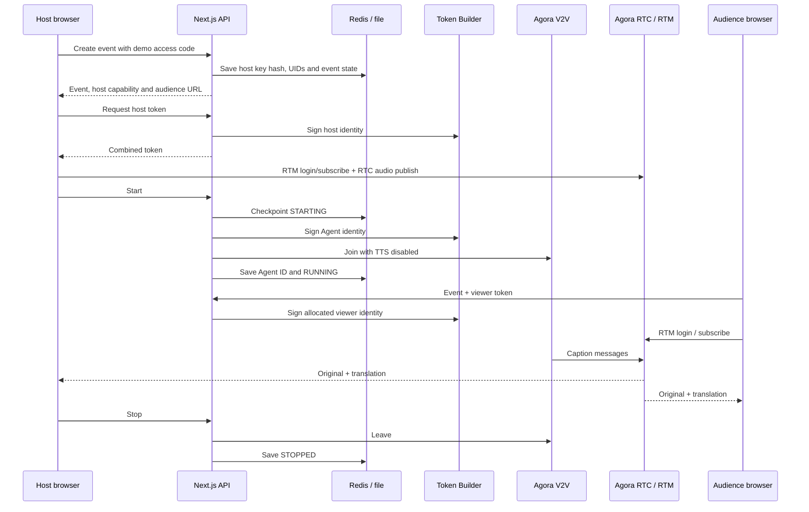

# Architecture / 架構

This document describes the implementation, not a vendor service guarantee. 本文件描述程式現況，並非廠商服務保證。

## Components

| Component | Responsibility |
| --- | --- |
| Host browser | Choose audio, publish RTC audio, subscribe to RTM captions, render/record text locally |
| Audience browser | Obtain a viewer identity, subscribe to RTM, read captions; no media publishing |
| Next.js Node.js routes | Event creation, host authorization, token requests, V2V control |
| Redis / local file | Event status, Agent identity, UID allocation and transaction lock |
| Token Builder | Combined RTC + RTM AccessToken2 signing using its own App Certificate |
| Agora V2V | Transcription and translation, TTS disabled |
| IndexedDB | Full transcript actually received by the host browser |

## API boundaries

Our application routes are `POST /api/events`, `GET /api/events/{id}`, `POST /api/events/{id}/tokens`, `start`, `stop`, `agent`, and protected `POST /api/cleanup`.

The V2V adapter uses `POST join`, `GET agents/{agentId}`, and `POST agents/{agentId}/leave` under the configured project service contract. These are short control requests. Host and viewer poll **our event state** every five seconds; that poll is not an Agora Agent query.

RTC/RTM SDK connections carry real-time data directly. Vercel does not host a persistent WebSocket broadcast server or relay every audio frame/caption. The optional local audience gateway serves pages/status/viewer tokens only; it denies host controls, server settings and source maps.

## Token Builder contract

Implement or deploy your own builder. The adapter currently sends HTTPS GET parameters:

| Parameter | Value |
| --- | --- |
| `channelName` | Server-assigned event channel |
| `uid` | Decimal RTC UID |
| `userUuid` | The same UID as an RTM user string |
| `role` | `host`, `viewer`, or `stt` |
| `expireTime` | Lifetime in seconds: browser 3600, Agent 86400 |

Expected response: JSON containing `token` (a `007` AccessToken2 string), optionally `role`. It must contain RTC and RTM services for the same App ID/identity. The adapter checks the envelope's App ID. Optional `TOKEN_BUILDER_API_KEY` sends Bearer auth only when the builder already supports it.

The website never receives an App Certificate. Secrets belong in the builder environment or server-only environment variables, not query parameters or `NEXT_PUBLIC_` variables. Agora's public Node builder examples are listed in [sources](sources.md); this repository does not ship a globally callable token endpoint or the author's Worker.

## State, concurrency and reconnection

- Local development uses an atomic file checkpoint and exclusive lock.
- Vercel requires Redis REST. Lock ownership is checked on checkpoint/release, so stale transactions cannot overwrite a new owner's state. The demo uses one state document and a global lock; high concurrency needs partitioning.
- `REDIS_KEY_PREFIX` isolates independent deployments. Use a distinct prefix/database for Preview and Production.
- A shared browser RTM client serializes login, recovery, renewal and logout. Transient SDK reconnect states do not trigger extra application logins.
- A source reselection in the same event/Agent generation reuses its transcript buffer. Old close/recovery callbacks cannot log out or mark a new transport connected.
- Agent join timeout is recorded as uncertain to prevent duplicate creation. An unresolved Agent requires inspection; the app does not falsely claim that it stopped.

## Media and transcript lifecycle

Browser display capture requires explicit user selection. A display video track can remain alive to preserve capture lifecycle; **only its audio track is published** to Agora. No screen frames are rendered, recorded or sent by this app. Stop/close/failure releases all owned raw capture tracks and SDK tracks.

When sharing ends, the host can choose another source and reconnect. The event remains available, but the external Agent's idle policy may reclaim it; reconnect checks the Agent instead of silently creating a duplicate. Existing captions and local archive are preserved.

The transcript buffer coalesces revised turn snapshots into sentences, retains up to 100 rendered rows and uses increasing sequence numbers. Mobile displays five recent completed pairs plus the current interim sentence. Manual readback freezes that small window until following resumes. Host IndexedDB keeps full received text independently of the rendered window. Missing/offline messages cannot be guaranteed to replay.

## Extension boundaries

Customers can replace the token/V2V adapters, add event administration, languages, branding, source integrations or server-side transcripts. Add authentication, distributed rate limiting, monitoring and data-retention policy according to deployment requirements. AI summaries, multi-speaker conferencing, automatic mixed-language detection and backend transcript storage are not part of this release.
